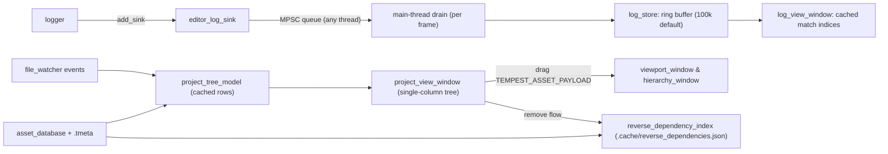

# Proposal: Editor Log View & Project View

## Status
Proposed. Child of [Editor & Scene System](editor_and_scene_system.md), Milestones M1 (logger), M2 (Log View) and M8 (Project View).

## Context
**Logger.**
- The engine logger (`engine/runtime/logger`) fixes its `vector<log_sink*>` at construction.
- Records carry only the level, the message and a `source_location`: no timestamp, no thread id.
- `standalone_engine_context::make_default_logger` overwrites the logger once per sink, so only the last sink survives (`tempest.cpp:23-38`).
- Logs come from job workers as well as the main thread.

**Panes.** There is no log pane and no asset browser.

Requirements covered: Log View 4a–e, Project View 5a–d, Editor 6.

---

## Proposed Architecture



## Detailed Design

### 1. Logger Extensions (M1)

```cpp
namespace tempest
{
    struct log_record
    {
        log_level level;
        uint64_t timestamp_ns;  // steady clock since engine start
        uint32_t thread_id;
        string_view message;    // valid only for the duration of do_log
        source_location source;
    };

    class log_sink
    {
      public:
        virtual auto do_log(const log_record& record) -> void = 0;
        // min/max level filtering is unchanged
    };

    class logger
    {
      public:
        auto add_sink(log_sink& sink) -> void;
        auto remove_sink(log_sink& sink) -> void;
        [[nodiscard]] auto wall_clock_base() const noexcept -> int64_t; // UTC ns at engine start
    };
}
```

- The sink list is protected by a lightweight reader/writer lock, because logging happens on many threads and adding or removing sinks is rare.
- The existing stdout sinks are updated to take the new signature.
- The `make_default_logger` bug is fixed: one logger is created with every default sink.

### 2. Log Store & Ingest (M2)
- **Capture.** `editor_log_sink::do_log` copies the message into a chunked string arena and pushes `{level, timestamp, thread, arena span, file, line}` onto an `mpsc` queue. It never touches UI state.
- **Drain.** `log_store::drain()` runs once per frame on the main thread and appends records to a ring buffer. Capacity comes from `.tproject` → `editor.log_capacity`, default 100,000. When the buffer is full, the oldest records are dropped and recycled, and a `dropped_count` is incremented.
- **Sequence numbers.** Every record gets a monotonically increasing `sequence` number. View state refers to records by sequence number, never by position in the ring, so eviction can never leave a dangling index.

### 3. Log View (M2)
- **Clear** (4b) sets `visible_from_sequence = next_sequence`. Nothing is freed, and only records ingested afterwards are shown.
- **Filters** (4c):
  - Level toggles, with a count per level shown on each toggle.
  - A time range, either relative ("last N s/min") or absolute from/to, in local wall-clock time computed from `wall_clock_base + timestamp_ns`.
- **Search** (4d): case-insensitive substring match on the message. Regex search is deferred.
- **Stateful view** (4e):
  - The window keeps a `vector<uint64_t> matches` of matching sequence numbers.
  - It is rebuilt from scratch only when the filter, search or clear state changes.
  - Newly drained records are tested once against the current filter and appended.
  - Records evicted from the ring are trimmed from the front of `matches`.
  - A relative time filter only re-evaluates once per second, and only trims from the front.
- **Rendering.**
  - Rows are drawn with `ImGuiListClipper` and show time, level badge, thread, message and `file:line`.
  - An auto-scroll toggle sticks to the bottom only while the user is already at the bottom.
  - Double-clicking a row copies it; right-click offers Copy, Copy All Filtered and Open Source Location.
- **Status bar.** The editor status bar shows a pill with the error and warning counts since the last clear. Clicking it focuses the Log View.

### 4. Project View (M8)

#### 4.1 Architecture & Cached Tree Model
- **`project_tree_model`**:
  - Encapsulates a hierarchical node tree rooted at the active workspace mount points.
  - Generates and caches a flattened list of visible rows consumed by `ImGuiListClipper`.
  - Maintains persistent expansion states for directories and imported files.
  - Driven by `file_watcher` events; invalidates and re-scans only affected directory nodes.
  - **Deferred invalidation**: Structural tree rebuilds triggered by background file events are deferred while an inline rename or drag-and-drop operation is active to prevent focus loss or input corruption.
- **`project_view_window`**:
  - Implements `editor_window`, docks initially at `dock_location::bottom`, and exposes `"Window" > "Project"` toggle.
  - Hosts the single-column virtualized tree, top breadcrumb bar, search filter bar, and context menu dispatchers.
  - Maintains internal item selection without disrupting `editor_selection` until asset inspection is active.
- **`reverse_dependency_index`**:
  - Maintained as an engine library component in `runtime/scene` (or `runtime/assets`).
  - Maps `asset guid -> [{owner: scene/prefab guid, id_path, component, field}]`.
  - Serialized as human-readable JSON at `.cache/reverse_dependencies.json`. Rebuilt on project open and updated incrementally on scene/prefab saves and asset imports.

#### 4.2 Workspace & Project Discovery
- **Launch Resolution**: The editor loads the project specified via `--project=<path>`. If omitted:
  - The editor checks the current working directory; if a single `.tproject` exists, it opens automatically.
  - Otherwise, a blocking modal dialog prompts the user to select from a "Recent Projects" list (persisted in `.cache/editor_session.json`), browse for an existing `.tproject`, or create a new project.
- **Mount Roots**: Each mount root declared in `project_workspace` (e.g. `assets`) is presented as a top-level node.

#### 4.3 Node Classification & Visual Presentation
- **Interleaved ordering**: Folders appear first, followed by files alphabetically.
- **Imported assets** (with `.tmeta` sidecar): Display type badge (e.g. `[Model]`, `[Prefab]`, `[Material]`, `[Scene]`) and expand with an arrow to list sub-assets (`prefab`, `mesh/0`, `material/0`, `texture/baseColor`).
- **Loose files** (without `.tmeta`): Displayed greyed out with a `[Loose]` badge. Context menu enables "Import" if a registered importer matches the file extension.
- **Hidden sidecars**: `.tmeta` sidecars are hidden from the tree.

#### 4.4 Navigation & Search Filtering
- **Breadcrumb navigation bar**: Horizontal path strip at the top (`assets > characters > enemies`) for fast directory jumping.
- **Search filtering**: Case-insensitive substring query on filename or path. When search is non-empty, the tree switches to a flattened view displaying all matching files and sub-assets alongside their relative paths. Clearing search restores the hierarchical tree and prior expansion states.

#### 4.5 Inline Renaming & Input Validation
- Triggered by $F2$ or context menu > Rename on any file or folder.
- Renders an inline `ImGui::InputText` overlay on the row.
- **Real-time validation**: Validates input buffer every keystroke against illegal OS characters (`/`, `\`, `:`, `*`, `?`, `"`, `<`, `>`, `|`), empty names, and existing file collisions. Highlights red with an error tooltip on collision; Enter/commit is disabled until valid.
- Pressing Enter commits file rename and associated `.tmeta` rename on disk, notifying `asset_database`. Pressing Escape cancels safely.

#### 4.6 Drag-and-Drop Instantiation & Payloads
- **Payload**: Draggable items set `TEMPEST_ASSET_PAYLOAD` containing the asset GUID and metadata, compatible with the Inspector property grid.
- **Hierarchy drop target**:
  - Dropping a prefab or model onto an entity row parents the instantiated prefab under that entity.
  - Dropping onto a scene header or blank space instantiates as a root entity in that scene.
  - Dropping a material onto an entity assigns its material.
  - Sub-assets (e.g. `mesh/0`, `material/0`, `prefab`) are draggable individually.
- **Viewport drop target**:
  - Raycasts from the camera into the scene. Instantiates at raycast hit point; if no surface is hit, positions $5\,\text{m}$ in front of `editor_camera`.
  - Displays a placement ghost preview while hovering.
  - Dropping a material onto an entity under the cursor assigns to that entity's material slot.
- **Undoable commands**: Instantiations and material assignments execute via `instantiate_prefab_command` and `assign_material_command` recorded in `command_history`.

#### 4.7 Context Actions & File Activation
- **Create > Folder / Material / Scene**: Creates directory or default `.tmaterial` / `.tscene` file and immediately activates inline rename mode.
- **Import / Reimport**:
  - Single-file import and reimport (preserving existing sub-asset GUIDs).
  - Bulk import for multiple selected loose files and folder-level recursive import.
- **Double-click activation**:
  - Folder: Toggles expansion state.
  - `.tscene`: Triggers Open Scene (Single).
  - `.tprefab` or `.tmaterial`: Focuses in Inspector.
  - Scripts, shaders, text files: Opens in configured external code editor (or OS default application).
- **Scene opening & dirty state protection**: Opening a scene (Single) checks for unsaved changes in currently loaded scenes. If dirty edits exist, a confirmation dialog prompts: `Save Changes to '<scene>'? [Save] [Don't Save] [Cancel]`.
- **Reveal in Explorer**: Opens OS file manager with the target file or folder selected.

#### 4.8 Asset Removal Flow & Dependency Resolution
- Triggered by right-click > "Remove from Project".
- Queries `reverse_dependency_index` for the target asset GUID:
  - **No references found**: Prompts simple confirmation dialog with a "Delete source file" checkbox. On confirm, deletes `.tmeta`, unregisters database entries, and removes source file if checked.
  - **References found**: Displays a modal warning dialog listing all referencing scenes, prefabs, and entity IDs with three actions:
    1. **Abort**: Cancels the removal operation without modifying files.
    2. **Leave dangling**: Deletes `.tmeta` and unregisters asset; existing references remain dangling (rendering missing-asset placeholders).
    3. **Remove referencing entities**: For currently open scenes, executes undoable `destroy_entity_command` instances; for unopened scenes and prefabs on disk, atomically updates JSON files on disk. If closed scenes are affected, the dialog prompts that disk rewrites cannot be undone and suggests opening them first.

## Public API Surface & Subsystem Invariants
- **Thread confinement.** Sinks never touch UI state. All view state is owned by the main thread.
- **Zero allocation per frame when idle.** A frame with no new logs and no input does no filtering work.
- **Shutdown order.** `editor_log_sink` is removed from the logger before it is destroyed. RAII registration handles guarantee this.

## Verification Plan

**`logger` tests (in `core-tests` or a new `logger-tests` target)**
- `add_sink` / `remove_sink` while other threads are logging.
- Timestamps are monotonic per thread.
- The default logger delivers to every sink (regression test for the last-sink bug).

**`scene-tests` / `assets-tests`**
- `reverse_dependency_index`: Construction from scenes and prefabs; querying references by asset GUID; JSON serialization round-trip to `.cache/reverse_dependencies.json`; incremental updates on save and import; stripping referencing entities across open registries and disk files.

**`editor-core-tests`**
- `log_store`: ring eviction and dropped count; sequence numbers stay stable across eviction.
- Clear hides earlier records and shows later ones.
- The incremental filter result equals a full rebuild after a random mix of ingest, filter and clear operations.
- Search is case-insensitive.
- Relative time window trimming.
- `project_tree_model`: classification of imported and loose files; sub-asset expansion; incremental invalidation touches only the affected directories; `.tmeta` files are hidden; flattened search mode matches query with relative paths; deferred invalidation during active editing and drag operations.

**TSan**
- Logger tests and `editor-core-tests` log-store tests: multiple producer threads, one main-thread drain.

**Manual**
- Flood 1M log lines from workers. The editor stays responsive and the drop counter increases.
- Filter by Error, search, then clear. Only new entries appear.
- Launch editor with and without `--project`; verify auto-discovery of working directory `.tproject` or modal selector.
- Create new folder, material, and scene; verify inline rename with invalid character / collision validation.
- Import loose `.glb` and reimport; verify sub-asset expansion.
- Drag prefab/model into hierarchy (parenting) and viewport (raycast hit / 5m fallback with placement ghost); verify undo/redo.
- Attempt to open a scene with unsaved changes; verify dirty scene protection prompt.
- Remove an asset referenced by a scene; verify removal modal options (`Abort`, `Leave dangling`, `Remove referencing entities`).

## Implementation Phases
| Phase | Subsystem | Description |
| :--- | :--- | :--- |
| M1 | logger | `log_record`, `add_sink` / `remove_sink`, timestamps and thread ids, default-logger fix |
| M2 | editor | `editor_log_sink`, `log_store`, `log_view_window`, status-bar pill |
| M8 | editor / scene | `project_tree_model`, `project_view_window`, `reverse_dependency_index`, drag-to-instantiate, context actions, removal flow |
